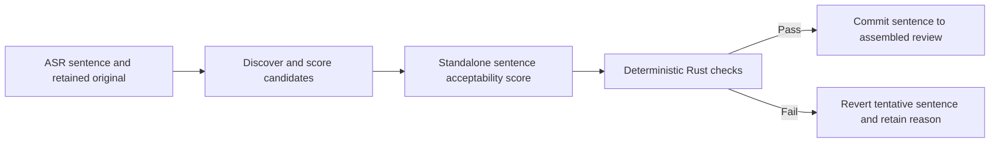

# Transcrust Cargo workspace

The workspace shares its engine code with native hosts through local Cargo
paths. The desktop CLI is the root package. See [the native ABI](ffi/README.md)
for ownership, errors, configuration and cancellation.

| Package | Responsibility |
|---|---|
| `transcrust-core` | PCM/resampling, deterministic text cleanup, correction proposals and glossary persistence. The `asr` feature adds direct Parakeet and Nemotron. |
| `transcrust-decision` | Glossary matching, current-sentence rules, optional inference for unresolved occurrences, UTF-8 edits and decision reasons. UltraBERT INT4 uses Candle. D1 uses ONNX Runtime. |
| `transcrust-ffi` | C ABI for host applications. Default features expose cleanup and learning. `decision` enables the rules and scoring path. `asr` enables complete-take PCM input. |
| `transcrust-phonon` | Separate native Rust ASR engine. A Rust host can call it directly. The current C ABI exposes Parakeet and Nemotron. |

## Work and compare here

Run from the Transcrust root on Linux. The workspace CLI enables the desktop
ORT provisioning features. A standalone native library build needs the host
ORT SDK or framework.

```sh
nix develop -c cargo test --locked --offline --release \
  -p transcrust -p transcrust-core -p transcrust-decision -p transcrust-ffi \
  --features transcrust-ffi/asr,transcrust-ffi/decision --lib --bin transcrust
nix develop -c cargo run --locked --offline --release -- --fix 'We made Chili for dinner.' --dec
```

The release suite covers the C boundary and the 150-case rule fixture. The
text probe uses the configured glossary and installed model. The
[model registry](../Models.md) records model identities, hashes and paths.
For an audio comparison, use the same engine, weights and WAV on both builds.
Keep each run's output directory.

```sh
nix develop -c cargo run --locked --offline --release -- \
  --wav tools/bench-clips/chat-05s.wav --mode parakeet --dec --output-dir /tmp/transcrust-replay
```

Compare the replay's raw ASR output, cleaned decision input, delivered text
and edit reasons before comparing times. For a change under review, capture
the source revision and working diff, Cargo.lock hash, feature flags, Rust
target and release profile, ORT version, model and glossary hashes, and
fixture revision.
Measure cold open, time to first review and process memory on the target.
Keep warm measurements when they answer the performance question at hand.
Same-engine ports should match the frozen text and decisions. Record output
changes explicitly when evaluating a new engine, prompt or checkpoint.

A minimal copied workspace with `core`, `decision` and `ffi` passed
`cargo test --offline -p transcrust-ffi --lib` and
`cargo check --locked --offline -p transcrust-ffi --features decision` on
Linux. That check covered source portability and the base C contract.

## Build the Android library

The validated Android path uses Cargo's `aarch64-linux-android` target, NDK
27.2.12479018 and the ONNX Runtime Android 1.24.3 AAR already used by Mopvox.
With a Rust toolchain that includes the Android target, set `ANDROID_NDK_HOME`
and `ORT_ANDROID_AAR`, then run:

```sh
bash tools/build-android-ffi.sh /tmp/transcrust-jni
```

The helper builds `transcrust-ffi` with `decision` and installs
`arm64-v8a/libtranscrust_ffi.so` in that directory. Mopvox's
`tools/build-decision-apk.sh` builds the JNI bridge and packages the Rust
library with the same ORT AAR. Mopvox supplies ASR, raw text and the selected
glossary path. The November 19 [smoke record](../TASKBOARD.md) covers typed
model inference, complete microphone takes and focused-editor delivery.
Build and run the Apple host separately with its target ORT packaging.

## Keep the inference stages separable

The smallest proven split is **ASR → raw UTF-8 text → Rust decisions → host
review**. The ASR caller owns PCM and capture. The host can feed text from
any ASR implementation to a decision-only `tc_process` handle. When using
an ASR-only `tc_transcribe` handle, take the response's `raw` field for that
handoff so cleanup runs once. Carry the take and field identity in the host.
An integrated handle with both features can also process a complete take.

### Capitalization and grammatical candidate evidence

John's November 19 direction treats capitalization as lexical evidence through
candidate generation, grammatical assessment, decisions and review. Preserve
the heard spelling and case alongside the canonical glossary spelling. The
glossary authorizes each name reading and its capitalization. A name decision
emits that exact spelling, with a reason for case-only edits as well.

Evaluate phonetic and word-boundary alternatives against dependency relations.
For a fused name/conjunction such as `Nelland`, a candidate must preserve both
`Nell` and `and`. Ordinary `gamble` and canonical `Gambol` retain their distinct
readings during grammatical assessment. This direction is pending implementation;
the current local-slot and phrase rules have reproduced failures recorded in
`~/syncthing/transcrust-work/window-study/README.md`.

### Proposed sentence validation and rollback

Retain an original sentence and a tentative revision under the parent take ID.
Candidate discovery includes dictionary spellings, phonetic alternatives,
word boundaries, case and grammatical diagnostics. Unchanged sentences also
reach validation so missed candidates remain observable.



Dependency structure supplies relations for the Rust rules. Canonical name
case, grammatical slots, entity descriptions, conjunction preservation and
edit provenance are checked explicitly. A failed tentative revision restores
that sentence's original text and retains its diagnostic for review. Other
accepted sentences keep their own revision state.

Measure candidate discovery coverage, model decisions, lint catches and final
dictionary errors independently. One fused boundary can contribute several
word errors, while a missing alias can prevent any checkpoint from being
created. The November 19 standalone UltraBERT acceptability probe shows weak
separation; the proposed linter and rollback remain pending implementation.

### Planned in-flight work under one utterance ID

John's November 19 direction is short Parakeet holds and sustained Nemotron
toggles. The next streaming contract should carry the existing stable take ID
from microphone start through capture, ASR, decisions, review and correction.
Each work item also needs an ordered chunk index, sample rate and absolute
start/end sample offsets, with an exclusive end. Use those offsets to associate
results with the parent recording and to assemble one complete review.

The host can persist one WAV and a sidecar containing chunk ranges. The crate
can process tagged PCM slices directly. Recording and file writes belong off
the inference path. This extends the existing corpus/correction ID convention.

Evaluate 6–12-second scheduling windows for completed text while carrying
unfinished sentence context into the next work item. Nemotron's encoder and
decoder state must span the entire utterance. Preserve its trained 1120 ms
graph chunks. Apply current-sentence dictionary decisions to each completed
sentence and carry every edit's text offsets into the assembled review.

Cancellation applies to the parent take, including queued chunks and pending
results. Deliver only the current take after explicit acceptance. Check ordering,
duplicate results, sentence seams, final-tail flushing and inference backlog
against the same saved long recording before phone acceptance. The IDs provide
association; sustained throughput determines the remaining work after stop.

This streaming contract is planned. The current FFI accepts complete PCM or
text calls, and current Android decisions still run after capture ends. The
November 19 Android follow-up starts UltraBERT initialization at mic activation
and retains the selected ASR/decision pipeline between Decision Test takes.

Inside the decision package candidate matching and deterministic rules run
against the cleaned text. `Worker::infer` is the current scoring
seam for unresolved candidates. If different hardware makes a large
inference improvement possible, first test replacing that scorer in place.
Keep tokenization, prompt rendering, option ordering and score validation
with the measured backend. Rules, glossary reload, text offsets, edits and
audit stay on the policy side. A failed scorer leaves rule edits intact.

Different backends can share one process. Consider a separate local process
only after measuring an advantage such as lower peak residency or a faster
first take, with model loading and data transfer included. At that boundary,
return one bounded result for each unresolved occurrence against the same
immutable text and take ID. The host discards late results when the take or
field changes. Keep ASR, decision policy and inference independently
measurable so the observed win can be attributed to the changed stage.

Today the `decision` feature includes the model stack even when the rules
settle the whole take. UltraBERT's math uses Candle, and the current crate
still needs ORT for the D1 code and common run options. A separate
rules-only build or a different accelerator is a feature boundary to prove
with the same fixtures if measurements justify that change.
